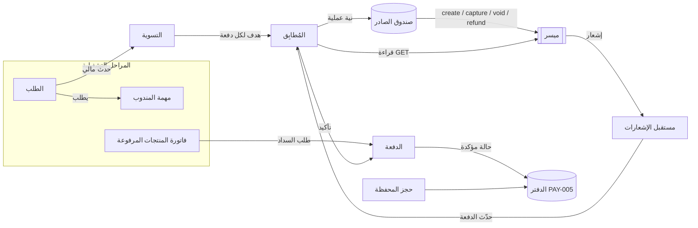

# نظام حالات الطلب والدفع

*   **Author:** hamzanasr
*   **Status:** Draft
*   **Date:** 2026-11-08
*   **خط الأساس:** `prd.md` الإصدار 4.18 (المراجعة 2026-11-04b). كل إشارة إلى متطلب هي إلى هذا الإصدار. التتبع بمعرّف المتطلب، وأرقام الأسطر للمراجعة فقط.
*   **المدخل:** [concepts_brief.md](concepts_brief.md) (مراجعة Goldfish بسبع عدسات، وبحثان في توثيق ميسر بتاريخ 2026-11-08).

--------------------------------------------------------------------------------

## Overview

هذه الوثيقة تصمّم للمطورين كيف يتتبع خادم منصة «محلات» حياة الطلب والمال المرتبط به، من لحظة الدفع حتى الإغلاق، في كل المسارات: المنيو والمارت بتوصيل، والكتابة والصيدلية، والاستلام الذاتي، والإغلاق دون تسليم.

المواصفات (ORD-001 إلى ORD-014، PAY-001 إلى PAY-031) تحدد القواعد التجارية. هذه الوثيقة تحوّلها إلى:

- **آلات حالات منفصلة** للطلب، ولكل دفعة في ميسر، ولكل مهمة مندوب، ولفاتورة المنتجات المرفوعة.
- **دالة تسوية واحدة** تقرر كم يُحصَّل ويُلغى ويُرد من كل دفعة.
- **مُطابِق** هو المكوّن الوحيد الذي يتصل بميسر، فيمنع تكرار العمليات المالية ويكتشف ما فات.

وتقترح الوثيقة تعديلات على `prd.md` حيث تتعارض المواصفات مع نفسها أو مع سلوك ميسر الموثق. التعديلات تُقدَّم بصيغة جدول «أسئلة مفتوحة» في المواصفات، ولا يُبنى انتقال يعتمد على تعديل قبل اعتماده (سطر 373).

القارئ الأول مطوّر الخادم. والقارئ الثاني المحاسب: كل انتقال يحرّك مالاً يشير إلى رقم قيد في «ملحق PAY-005».

## The Problem

### ما يحتاجه المطوّر ولا تعطيه المواصفات

المواصفات تصف ما يراه العميل وما يحدث للمال في كل حالة، لكنها لا تعطي نموذجاً يمكن برمجته مباشرة، لثلاثة أسباب:

**1. المواصفات تناقض نفسها في بنية الحالة.** ORD-001 يقول إن «حالة الطلب والدفع ومهمة المندوب وفاتورة المنتجات حقول مستقلة». لكن جداول الحالات (الأسطر 5–66) تدمجها في عمود واحد، وتسمّي حالات الطلب بكلمات دفع: «مدفوع: مهلة الإلغاء»، «دُفع التوصيل: مهلة الإلغاء». وسطر 66 يقول إن هذه الأسماء «معتمدة للبرمجة». إن بُنيت كما هي:

- لا يمكن تمثيل طلب مفتوح بدفعة محصَّلة، وهو ما يحدث عند التحصيل الآلي بعد 24 ساعة (PAY-001).
- يتضاعف عدد الحالات مع كل مسار ومع كل دفعة إضافية.
- تغيير الأسماء لاحقاً يحتاج ترحيل بيانات.

**2. المواصفات تفترض سلوكاً لا تقدمه ميسر.** من توثيق ميسر:

| ما تفترضه المواصفات | ما توثقه ميسر | العاقبة إن بُني حرفياً |
|---|---|---|
| «يحصّل ما يستحق ويلغي حجز الباقي» (PAY-001) | الإلغاء بعد التحصيل يعكس الدفعة كلها؛ والتحصيل الجزئي هو الذي يحرر الباقي | يُعكس تحصيل طلب مسلَّم بالكامل |
| زر إعادة المحاولة «يعيد الطلب نفسه بمعرّفه لمنع التكرار» (A18 سطر 2560) | منع التكرار بـ `given_id` في إنشاء الدفعة فقط؛ لا شيء يمنعه في التحصيل والإلغاء والاسترداد | استرداد مكرر عند انقطاع الشبكة |
| حصة الفرع تُقسَّم «عند التحصيل، لا عند الحجز» (PAY-006) | التقسيم يُثبَّت عند التفويض، وطلب التحصيل يقبل المبلغ فقط | حصة الفرع خاطئة في كل طلب تغيّر مبلغه بعد الدفع |
| كل وسائل الدفع تدعم الحجز (PAY-001، INT-001) | مدى موثق (14 يوماً)؛ Apple Pay و Google Pay غير موثقين | طلبات بوسيلة لا تدعم الحجز تُعامل كأنها محجوزة |
| الحالة المحجوزة تعكس الواقع | إذا أسقط المُصدِر الحجز تبقى الحالة `authorized` | يفشل التحصيل بعد التسليم دون مالك للخسارة |
| الإشعار مصدر الحالة (SYS-015، PAY-001 سطر 3435) | 6 محاولات خلال نحو 3 ساعات و41 دقيقة ثم يُسقط الحدث؛ لا ضمان للترتيب أو لعدم التكرار | دفعات معلقة بلا تحديث |

**3. المال على الطلب ليس دفعة واحدة.** المواصفات تقول «الحجز» بالمفرد، لكن الطلب الواحد قد ينشئ عدداً مفتوحاً من الدفعات: التوصيل ثم المنتجات في الكتابة (ORD-013)، وفرق كل تصحيح موقع (ORD-009)، وفرق كل بديل أغلى (MER-032، PAY-028)، وإكرامية بعد التسليم (CUS-010)، إضافة إلى رصيد المحفظة الذي ليس دفعة في ميسر أصلاً (PAY-002). ومهلتا 24 و18 ساعة (PAY-001) لا تقولان من أي دفعة تُحسبان.

### لماذا يهم

- **مال العميل:** تحصيل مزدوج، أو استرداد لا يصل، أو تحصيل لطلب أُلغي.
- **مال التاجر:** حصة خاطئة في محفظته لدى ميسر، أو حصة تُحوَّل قبل قرار دعم يستردها.
- **مال المنصة:** رسوم استرداد كان يمكن تجنبها بالإلغاء (الإلغاء بلا رسوم في ميسر، والاسترداد برسوم)، وخسائر بلا قيد.
- **التدقيق:** المواصفات تشترط أن يسجّل كل انتقال منفذه ووقته (ORD-001) وأن يتوازن الدفتر يومياً (PAY-005). هذا غير ممكن إن لم يكن للعملية المالية المعلقة حالة.

### الحل المقترح باختصار

- يُفصل الطلب إلى مكوّنات لكل منها حالاته وانتقالاته.
- الطلب لا يتصل بميسر: كل انتقال يحرّك مالاً يكتب ما يجب أن يكون عليه المال (الهدف).
- دالة التسوية تحسب لكل دفعة ما يُحصَّل ويُلغى ويُرد.
- المُطابِق يسجّل نية كل عملية قبل إرسالها، ويقرأ حالة الدفعة من ميسر قبل أي إعادة، ويقارن بالهدف حتى يصبح الفرق صفراً.

التفاصيل في «Technical Plan».

## Goals

1.  **نموذج حالات قابل للبرمجة:** لكل مكوّن جدول حالات وجدول انتقالات بأعمدة ثابتة: `المعرّف | من | الحدث | الشرط | المنفذ | الإجراء | إلى | عملية ميسر | رقم القيد | مراجع PRD | التعديل المقترح`. لا يحتاج المطوّر أن يقرر سلوكاً لم تقرره الوثيقة.
2.  **تغطية كاملة للمواصفات:** كل قاعدة وكل معيار قبول في ORD-001 إلى ORD-014، وفي متطلبات PAY الداخلة في النطاق، مربوط بانتقال أو ثابت أو مؤقت واحد على الأقل. ومصفوفة تتبع في الاتجاهين تعرض «قاعدة بلا انتقال» و«انتقال بلا قاعدة»، وكلتاهما فارغة عند الاعتماد.
3.  **لا يبقى مال بلا مالك:** كل حالة غير نهائية لها مهلة أو مالك مسمى، وكل حالة نهائية للطلب تنتهي بكل دفعاته في حالة نهائية أو مغطاة بسياسة موعد.
4.  **لا عملية مالية مكررة:** إعادة أي حدث أو أي طلب إلى ميسر، في أي ترتيب، لا تنتج تحصيلاً أو استرداداً ثانياً. يُثبت ذلك باختبارات إعادة الحدث وحقن الأعطال.
5.  **الدفتر يطابق ميسر:** لا قيد إلا لحالة أكدتها ميسر، والمطابقة اليومية مع أسطر التسوية في ميسر لا تُظهر فرقاً غير مفسر.
6.  **حساب بالهللة يطابق الأمثلة:** كل مثال في «أمثلة العمليات المالية» وفي معايير قبول PAY يُعاد إنتاجه بالهللة حرفياً، ومنها 88.75 و101.77.
7.  **سباقات محسومة:** لكل سباق معروف (مثل الإلغاء عند الثانية 59.9 مقابل مؤقت الستين، وقبول مندوب عند 15:00) قاعدة حسم مكتوبة واختبار حدود.
8.  **تعديلات مقترحة جاهزة للاعتماد:** كل تعارض بين المواصفات وميسر أو داخل المواصفات له تعديل مقترح بصيغة جدول الأسئلة المفتوحة: السؤال، ومن يحسمه، وما الذي يتوقف عليه، والمتطلبات المتأثرة.

## Non-Goals

*   **Taxi:** بنية مؤجلة بنص ORD-001.
*   **دورات التحويل إلى البنوك والاعتماد** (PAY-006 الأسطر 3516–3520، القيود 14–17). الوثيقة تحدد فقط متى تصبح حصة الفرع قابلة للتحويل.
*   **تأمين المندوب ورصيده السالب** (PAY-024، PAY-026): قد يعيدان استعمال آلة الدفع، لكن لا طلب لهما.
*   **التقسيط** (PAY-015)، والسحب المبكر (PAY-018)، وSTC Pay.
*   **إصدار الفواتير في Odoo** (INT-010)، إلا قاعدة «لا إصدار قبل تحصيل مؤكد».
*   **انتهاء أرصدة المحفظة والمكافآت والنقاط والإعلانات** (PAY-002، PAY-031). الوثيقة تغطي حجز رصيد المحفظة على الطلب وصرفه وتحريره فقط.
*   **حفظ الدواء 7 أيام وإعادة توصيله** (PHR-010): سجل حفظ منفصل لا حالة طلب.
*   **أدوات الدعم وشاشاته:** طابور الـ18 ساعة بوصفه إشعاراً، والتقارير الأسبوعية، وتصميم نافذة الإلغاء. الوثيقة تحدد البيانات التي يجب أن تدخلها النافذة لا شكلها.
*   **خوارزمية التوزيع** (DSP-001): الوثيقة تأخذ أحداثها (عرض، قبول، توقف عند 15 دقيقة) مدخلاً، ولا تصمم الترتيب والأوزان.
*   **تجميع الطلبات:** مكان محجوز فقط في مهمة المندوب.
*   **الترحيل من المنصة السابقة** (TRN).
*   **كتابة كود إنتاج:** الوثيقة تصميم، والأمثلة شبه كود.

## Open Questions

أسئلة يحسمها المالك (تُطرح واحداً واحداً عند الوصول إلى القسم الذي يعتمد عليها):

*   **س1 — توقيت تقسيم المدفوعات:** التقسيم يُثبَّت عند التفويض في ميسر، والمواصفات تحسب الحصة عند التحصيل. الخيارات في Technical Plan. ويعتمد عليها: PAY-006، PAY-010، PAY-028، والقيود 4 و5.
*   **س2 — المحفظة:** قصر رصيد المحفظة على حصة المنصة، أم إيداع حصة الفرع الممولة منها بتحويل داخلي (`POST /internal_transactions`)؟ ويعتمد عليها: PAY-002، PAY-006، PAY-011، PAY-029.
*   **س3 — موعد الـ24 ساعة:** موعد واحد للطلب من أول حجز، أم موعد لكل دفعة؟ ويعتمد عليها: PAY-001، ORD-001، ومؤقت التصعيد بعد 18 ساعة.
*   **س4 — نتيجة افتراضية عند الموعد:** هل يُحصَّل عند الموعد مبلغ افتراضي لكل سبب في «بانتظار قرار الدعم» بدل المبلغ كاملاً؟
*   **س5 — خسارة سقوط الحجز بعد التسليم:** من يتحملها، وهل يُسمح بتحصيلها من البطاقة المحفوظة بموافقة مسبقة؟
*   **س6 — التحويل إلى استلام ذاتي:** الحجز نفسه بتحصيل أقل، أم إلغاء وحجز جديد؟
*   **س7 — المهل الناقصة:** مهلة مراجعة التاجر لطلب الكتابة، ومهلة الإسناد اليدوي في المارت ومخرجها.
*   **س8 — التأجيل من الإطلاق:** تصحيح الموقع المدفوع بعد الاستلام، والبدائل الأغلى.

أسئلة لدعم ميسر (لا يجيب عنها التوثيق العام):

*   **م-س1:** كيف يتصرف التقسيم عند التحصيل الجزئي: يُوزَّع بالنسبة، أو يُرفض، أو يذهب الباقي لطرف محدد؟
*   **م-س2:** هل للمنصة أن تخصم من محفظة فرع (Entity) خارج دفعة؟
*   **م-س3:** هل يُسمح بأكثر من استرداد جزئي على الدفعة الواحدة، وهل `refunded` تراكمي؟
*   **م-س4:** ما رمز الخطأ عند تحصيل حجز أسقطه المُصدِر؟
*   **م-س5:** ما حدود معدل الطلبات (429)؟
*   **م-س6:** هل يدعم Apple Pay و Google Pay الحجز (`manual`)، وما نافذة فيزا وماستركارد؟

## Critical User Journeys (CUJs)

### CUJ 1: طلب منيو يُسلَّم بعد حذف صنف نفد

*   **Given**: طلب منيو بدفعة واحدة محجوزة 129.93 بتقسيم للفرع 88.75، والعميل اختار مسبقاً «احذف الصنف» عند النفاد.
*   **When**: يحذف التاجر صنفاً بـ 21 ريالاً، ثم يسلّم المندوب الطلب.
*   **Then**: تحسب التسوية المستحق الجديد وحصة الفرع الجديدة. يُحصَّل الحجز كاملاً، ثم يُرد الفرق للعميل، ويُعكس من تقسيم الفرع قدر نقص حصته. لا يُرسل إلغاء بعد التحصيل. يُقيَّد الإيراد بعد تأكيد التحصيل، والاسترداد بعد تأكيده.

### CUJ 2: طلب كتابة يُحصَّل آلياً وبلاغه مفتوح

*   **Given**: طلب كتابة بحجزين، التوصيل في الساعة 0 والمنتجات في الساعة 2، والطلب في «بانتظار قرار الدعم».
*   **When**: تصل الساعة 18 من الحجز الأول، ثم الساعة 24.
*   **Then**: عند 18 يُصعَّد لمشرف الدعم. عند 24 يُحصَّل الحجزان معاً، ويصل العميل إشعار PAY-001، وتبقى حصة الفرع خارج قائمة التحويل. قرار الدعم بعدها يُنفَّذ استرداداً.

### CUJ 3: انقطاع الشبكة أثناء الاسترداد

*   **Given**: قرار دعم برد 40 ريالاً من دفعة محصَّلة.
*   **When**: يُرسل طلب الاسترداد إلى ميسر وينتهي الوقت دون رد.
*   **Then**: تصبح العملية «مجهولة». يقرأ المُطابِق الدفعة: إن زاد `refunded` بـ 4000 هللة تُعدّ مؤكدة، وإن لم يتغير يُعاد الإرسال مرة، وإن تغير بقيمة أخرى تذهب إلى طابور المطابقة. لا يُرد 40 مرتين في أي حال.

### CUJ 4: لا مندوب، والعميل يختار الاستلام الذاتي

*   **Given**: طلب منيو في غير المارت، مرت 15 دقيقة بلا مندوب.
*   **When**: يختار العميل الاستلام الذاتي في الدقيقة الثالثة من نافذة الخمس دقائق.
*   **Then**: يتغير نمط التنفيذ مرة واحدة، وتُلغى مهمة المندوب، ويصل الطلب للتاجر في «عند التاجر». الحجز نفسه يبقى. عند تأكيد التاجر الاستلام يُحصَّل كاملاً، ثم يُرد التوصيل والإكرامية وفرق رسوم الخدمة.

### CUJ 5: سقوط الحجز عند المُصدِر

*   **Given**: طلب سُلِّم، ودفعته تظهر `authorized` في ميسر.
*   **When**: يرفض ميسر التحصيل.
*   **Then**: تنتقل الدفعة إلى «سقط الحجز» وتُفتح مهمة للمالية. الطلب يبقى «تم التسليم»، ولا يتغير ما يراه العميل.

## Technical Plan (Architecture)

### القرارات المعتمدة في هذه الجلسة

| # | القرار | اختيار المؤلف | ما يترتب عليه |
|---|---|---|---|
| ق1 | متى تُثبَّت حصة الفرع على دفعة ميسر | **عند الحجز، بمبلغ محدد.** الدفعة التي تحمل تقسيماً تُحصَّل كاملة أو تُلغى كاملة، ولا تُحصَّل جزئياً | كل تخفيض على دفعة مقسّمة يصير تحصيلاً كاملاً ثم استرداداً برسوم. تعديل PAY-006 و PAY-028 |
| ق2 | المحفظة | **رصيد المحفظة يغطي حصة المنصة فقط** (التوصيل ورسوم الخدمة والإكرامية)؛ المنتجات بالبطاقة دائماً | مبلغ البطاقة ≥ حصة الفرع دائماً، فيتسع التقسيم. تعديل PAY-002 و PAY-011 |
| ق3 | مهلة 24 ساعة | **موعد واحد للطلب** D = وقت تفويض أول حجز + 24 ساعة، ترثه كل الحجوزات وتُحصَّل معاً | التصعيد عند D − 6 ساعات (18 ساعة). تعديل PAY-001 |
| ق4 | التحويل إلى استلام ذاتي | **الحجز نفسه**، تحصيل كامل عند الاستلام ثم استرداد التوصيل والإكرامية وفرق الخدمة | يتفق مع نص سطر 98 حرفياً. التحويل ليس حالة نهائية |

### المكوّنات



**القاعدة الحاكمة:** الطلب والمهمة والفاتورة لا تتصل بميسر ولا تكتب في الدفتر. كل انتقال يحرّك مالاً يرسل حدثاً إلى التسوية. التسوية تحسب الحالة المالية المستهدفة لكل دفعة. المُطابِق يجعل ميسر يطابق الهدف، والدفتر لا يُكتب إلا بعد تأكيد ميسر.

| المكوّن | ما يملكه | ما لا يفعله |
|---|---|---|
| الطلب | المرحلة التشغيلية، والمسار، ونمط التنفيذ، وسبب الإغلاق، والمؤقتات التشغيلية | لا يعرف حالة ميسر، ولا يمنع الإغلاق انتظاراً لتحصيل |
| مهمة المندوب | العرض والقبول والاستلام والوصول والتسليم والإرجاع لكل إسناد | لا تغيّر حالة الطلب إلا بإرسال حدث |
| فاتورة المنتجات المرفوعة | نسخ الصورة والمبلغ، ومهلة السداد، والرفض | لا تنشئ دفعة بنفسها؛ تطلبها من التسوية |
| الدفعة | آخر حالة أكدتها ميسر لدفعة واحدة، والمبالغ المحجوزة والمحصَّلة والمستردة، والتقسيم | لا تُحدَّث من حمولة إشعار؛ فقط من قراءة GET أو رد ميسر المباشر |
| حجز المحفظة | الرصيد المحجوز من المحفظة على الطلب ونوعه | لا يغطي حصة الفرع (ق2) |
| التسوية | دالة واحدة (PAY-028) تحسب المستحق لكل طرف وتحوّله إلى هدف لكل دفعة | لا تتصل بميسر |
| المُطابِق وصندوق الصادر | نوايا العمليات، والإرسال، والقراءة قبل الإعادة، وطابور المطابقة | لا يقرر مبالغ؛ ينفذ الهدف فقط |

### نموذج البيانات (مخطط منطقي، لا DDL)

```text
orders
  id, path {MENU, MART, WRITE, PHARMACY}, fulfilment_mode {DELIVERY, SELF_PICKUP},
  fulfilment_mode_changed_at (null أو مرة واحدة),
  state, state_version (عدّاد للتحكم في التزامن),
  awaiting_support_reason (null أو قيمة من قائمة ORD-001),
  closure_kind {DELIVER, CANCEL, TERMINATE} (null حتى الإغلاق),
  closure_reason, closed_via_support (bool), closed_at,
  money_deadline_at (D = تفويض أول حجز + 24 س), escalation_at (D − 6 س),
  merchant_ready_at (يُسجَّل ولو قبل قبول المندوب في الكتابة),
  settings_snapshot (المهل والنسب والعقد ورسوم التوصيل وقت التأكيد)

order_transitions            -- سجل لا يُعدَّل
  id, order_id, from_state, to_state, event, actor_type, actor_id,
  reason_text, occurred_at, state_version_after

payments                     -- صف لكل دفعة في ميسر
  id (= given_id = id الدفعة في ميسر), order_id, purpose, seq,
  capture_mode {HOLD, IMMEDIATE}, environment {TEST, LIVE},
  amount_halalas, wallet_halalas_on_order (للعلم),
  split_branch_halalas, split_basis_version, split_refundable (true),
  status {INITIATED, AUTHORIZED, CAPTURED, VOIDED, FAILED, HOLD_LOST, ABANDONED},
  captured_halalas, refunded_halalas,
  authorized_at, deadline_at (= orders.money_deadline_at),
  last_synced_at, moyasar_status_raw

moyasar_operations           -- صندوق الصادر
  id, payment_id, kind {CREATE, CAPTURE, VOID, REFUND}, amount_halalas,
  expected_before {status, captured_halalas, refunded_halalas},
  state {PENDING, SENT, CONFIRMED, REJECTED, UNKNOWN, NEEDS_REVIEW},
  attempts, last_error, settlement_run_id, created_at, sent_at, resolved_at
  -- فهرس فريد جزئي: عملية واحدة غير منتهية لكل payment_id

settlement_runs              -- كل تشغيل للتسوية وسببه
  id, order_id, trigger_event, decision_ref (قرار الدعم إن وجد),
  allocation {customer, driver, branch, platform} بالهللة,
  targets [{payment_id, target_status, target_captured, target_refunded}]

wallet_reservations
  id, order_id, balance_type {REFUND, COMPENSATION, PROMO}, amount_halalas,
  covers {DELIVERY, SERVICE, TIP}, status {RESERVED, CONSUMED, RELEASED}

webhook_events
  event_id (فريد), type, received_at, payment_id, processed_at
```

`purpose` للدفعة:

| الغرض | متى تُنشأ | تقسيم للفرع | نمط التحصيل | يُسمح بالتحصيل الجزئي |
|---|---|---|---|---|
| `MENU_FULL` | دفع طلب المنيو أو المارت | نعم: حصة الفرع | HOLD | لا (ق1) |
| `WRITE_DELIVERY` | الدفعة الأولى في الكتابة والصيدلية: التوصيل والإكرامية | لا | HOLD | نعم |
| `WRITE_PRODUCTS` | سداد فاتورة المنتجات: المنتجات وخدمة 5% | نعم: حصة الفرع | HOLD | لا (ق1) |
| `LOCATION_DELTA` | دفع فرق تصحيح الموقع (ORD-009) | لا | HOLD | نعم |
| `SUBSTITUTION_DELTA` | قبول العميل بديلاً أغلى (MER-032) | نعم: نصيب الفرع من الفرق | HOLD | لا (ق1) |
| `POST_TIP` | إكرامية بعد التسليم (CUS-010) | لا | IMMEDIATE | لا ينطبق |

وسيلة لم يُثبت دعمها للحجز في تجربة ما قبل الإطلاق تُنشأ دفعتها بنمط `IMMEDIATE` (PAY-001 سطر 3423)، ويُحفظ النمط على الدفعة عند إنشائها، فلا يتأثر بتعطيل وسيلة لاحقاً.

### آلة حالات الطلب

**الحالات** (المعرّف ثابت للبرمجة، والاسم العربي للعرض الداخلي):

| المعرّف | الاسم | نهائية | ما يراه العميل |
|---|---|---|---|
| `CANCEL_WINDOW` | مهلة الإلغاء | لا | نبحث عن مندوب (منيو ومارت) / يراجع المتجر طلبك (كتابة) / جاري التجهيز (استلام ذاتي) |
| `MERCHANT_REVIEW` | مراجعة التاجر | لا | يراجع المتجر طلبك |
| `AWAITING_PRODUCT_PAYMENT` | بانتظار سداد المنتجات | لا | يراجع المتجر طلبك، مع طلب السداد |
| `DISPATCHING` | البحث عن مندوب | لا | نبحث عن مندوب (منيو ومارت) / جاري التجهيز (كتابة) |
| `NO_DRIVER_CHOICE` | اختيار العميل بعد تعذر المندوب | لا | شاشة C24 |
| `MANUAL_ASSIGN` | إسناد يدوي (مارت) | لا | نبحث عن مندوب |
| `AT_MERCHANT` | عند التاجر | لا | جاري التجهيز |
| `READY` | جاهز | لا | جاري التجهيز |
| `READY_FOR_PICKUP` | جاهز للاستلام | لا | صفحة جاهز مع الاتجاهات |
| `PICKED_UP` | استلمه المندوب | لا | جاري التوصيل |
| `ARRIVED` | وصل المندوب | لا | جاري التوصيل |
| `RETURNING_TO_PHARMACY` | يعود للصيدلية | لا | نص PHR-010 |
| `AWAITING_SUPPORT` | بانتظار قرار الدعم | لا | آخر خطوة رآها العميل، مع «طلبك قيد المراجعة» |
| `DELIVERED` | تم التسليم | نعم | تم التسليم |
| `COLLECTED` | تم الاستلام | نعم | تم التسليم |
| `CANCELLED` | ملغى | نعم | نص سبب الإغلاق |
| `TERMINATED` | مُنهى | نعم | نص سبب الإغلاق |
| `RETURNED` | أُعيد | نعم | نص PHR-010 |

كل حالة نهائية تحمل `closure_kind` و `closure_reason` و `closed_via_support`. فالحالات النهائية السبع في جدول المواصفات (الأسطر 56–64) تصير تركيبات:

| حالة المواصفات | الحالة | closure_reason | via_support |
|---|---|---|---|
| ملغى خلال المهلة | `CANCELLED` | `CUSTOMER_IN_WINDOW` | لا |
| ملغى بلا مندوب | `CANCELLED` | `NO_DRIVER_CUSTOMER_REFUND` أو `NO_DRIVER_SUPPORT` | حسب المنفذ |
| ملغى بالدعم | `CANCELLED` | `SUPPORT_CANCEL` | نعم |
| أُغلق بقرار الدعم | `CANCELLED` أو `TERMINATED` حسب القرار | سبب «بانتظار قرار الدعم» الأصلي | نعم |
| حُوِّل إلى استلام ذاتي | **ليست نهائية**: تغيير `fulfilment_mode` (ق4) | — | — |
| أُنهي لعدم التجاوب | `TERMINATED` | `NO_RESPONSE` | نعم |
| يعود للصيدلية ← أُعيد | `RETURNING_TO_PHARMACY` ثم `RETURNED` | `PHARMACY_RETURN` | نعم |

**جدول الانتقالات.** الأعمدة: المعرّف، من، الحدث، الشرط، المنفذ، إلى، أثر مالي (حدث يُرسل للتسوية)، مراجع.

| ID | من | الحدث | الشرط | المنفذ | إلى | أثر مالي | مراجع |
|---|---|---|---|---|---|---|---|
| O-01 | (جديد) | `first_hold_authorized` | الدفعة الأولى (`MENU_FULL` أو `WRITE_DELIVERY`) أصبحت AUTHORIZED أو CAPTURED (IMMEDIATE) | النظام | `CANCEL_WINDOW` | ضبط D و escalation_at | ORD-002، PAY-001 |
| O-02 | `CANCEL_WINDOW` | `customer_cancel` | وقت استلام الخادم < نهاية المهلة، والانتقال O-03 لم يُثبَّت | العميل | `CANCELLED` (CUSTOMER_IN_WINDOW) | هدف: إلغاء كل الحجوزات، تحرير المحفظة | ORD-002، PAY-001 |
| O-03 | `CANCEL_WINDOW` | `timer.cancel_window` | المسار منيو أو مارت والنمط توصيل | النظام | `DISPATCHING` | لا | ORD-002، DSP-001 |
| O-04 | `CANCEL_WINDOW` | `timer.cancel_window` | المسار كتابة أو صيدلية | النظام | `MERCHANT_REVIEW` | لا | ORD-013 |
| O-05 | `CANCEL_WINDOW` | `timer.cancel_window` | النمط استلام ذاتي (منيو غير المارت) | النظام | `AT_MERCHANT` | لا | EXT-006، ORD-006 |
| O-06 | `MERCHANT_REVIEW` | `invoice.payment_requested` | الفاتورة المرفوعة فيها صورة ومبلغ | التاجر | `AWAITING_PRODUCT_PAYMENT` | لا | ORD-013 |
| O-07 | `MERCHANT_REVIEW` | `merchant_reject` | سبب من القائمة؛ «أخرى» مع نص | التاجر | `AWAITING_SUPPORT` (REJECTED_BEFORE_INVOICE) | لا (تجميد) | ORD-004، ORD-013، PHR-012 |
| O-08 | `MERCHANT_REVIEW` | `timer.merchant_review` | **متوقف على س7** | النظام | `AWAITING_SUPPORT` (MERCHANT_NO_REVIEW) | لا | تعديل مقترح |
| O-09 | `AWAITING_PRODUCT_PAYMENT` | `products_hold_authorized` | الدفعة مرتبطة بنسخة الفاتورة الحالية، والمهلة لم تنتهِ | العميل | `DISPATCHING` | لا | ORD-013 |
| O-10 | `AWAITING_PRODUCT_PAYMENT` | `invoice.corrected` | أول تصحيح فقط | التاجر | `AWAITING_PRODUCT_PAYMENT` (المهلة تبدأ من جديد) | إلغاء أي دفعة منتجات معلقة لنسخة قديمة | ORD-013 |
| O-11 | `AWAITING_PRODUCT_PAYMENT` | `timer.product_payment` أو `customer_reject_invoice` | — | النظام أو العميل | `AWAITING_SUPPORT` (NOT_PAID) | لا (تجميد) | ORD-013، ORD-001 |
| O-12 | `DISPATCHING` | `task.accepted` | لا مهمة نشطة أخرى | المندوب | `AT_MERCHANT`، أو `READY` إن كان `merchant_ready_at` مضبوطاً (كتابة) | لا | ORD-003، ORD-006 |
| O-13 | `DISPATCHING` | `timer.dispatch_15m` | منيو غير المارت | النظام | `NO_DRIVER_CHOICE` | لا | ORD-004 |
| O-14 | `DISPATCHING` | `timer.dispatch_15m` | مارت | النظام | `MANUAL_ASSIGN` | لا | ORD-004 |
| O-15 | `DISPATCHING` | `timer.dispatch_15m` | كتابة أو صيدلية | النظام | `AWAITING_SUPPORT` (NO_DRIVER_AFTER_PAYMENT) | لا (تجميد) | ORD-004 |
| O-16 | `NO_DRIVER_CHOICE` | `customer_choose_pickup` | قبل نهاية الخمس دقائق، و `fulfilment_mode` لم يتغير | العميل | `AT_MERCHANT` مع `fulfilment_mode = SELF_PICKUP` | إعادة حساب المستحق: يسقط التوصيل والإكرامية ويُعاد حساب الخدمة (ق4) | EXT-006، PAY-021 |
| O-17 | `NO_DRIVER_CHOICE` | `customer_choose_refund` | قبل نهاية الخمس دقائق | العميل | `CANCELLED` (NO_DRIVER_CUSTOMER_REFUND) | هدف: إلغاء الحجز كاملاً | ORD-004، PAY-001 |
| O-18 | `NO_DRIVER_CHOICE` | `timer.no_driver_choice` | — | النظام | `AWAITING_SUPPORT` (NO_CUSTOMER_CHOICE) | لا (تجميد) | ORD-004، تعديل مقترح |
| O-19 | `MANUAL_ASSIGN` | `support.assign_driver` | مندوب محدد | موظف الدعم | `AT_MERCHANT` (مهمة جديدة مقبولة) | لا | ORD-004 |
| O-20 | `MANUAL_ASSIGN` | `support.cancel` | سبب مكتوب ومسؤول أو «لا تحميل» | موظف الدعم | `CANCELLED` (NO_DRIVER_SUPPORT) | هدف: إلغاء الحجز كاملاً | ORD-004 |
| O-21 | `AT_MERCHANT` | `merchant_ready` | النمط توصيل | التاجر | `READY` | لا | ORD-003 |
| O-22 | `AT_MERCHANT` | `merchant_ready` | النمط استلام ذاتي | التاجر | `READY_FOR_PICKUP` | لا | EXT-006 |
| O-23 | `READY` | `task.picked_up` | كود المندوب الحالي أُدخل داخل 100 م | التاجر | `PICKED_UP` | لا | ORD-005 |
| O-24 | `PICKED_UP` | `task.arrived` | داخل 100 م من العميل | المندوب | `ARRIVED` | لا | ORD-008 |
| O-25 | `ARRIVED` | `task.delivered` | داخل 100 م، ودليل التسليم، وصورة إن كان تركاً عند الباب | المندوب | `DELIVERED` | هدف: تحصيل المستحق | ORD-005، ORD-010 |
| O-26 | `READY_FOR_PICKUP` | `merchant_confirm_collected` | رقم الطلب مطابق | التاجر | `COLLECTED` | هدف: تحصيل المستحق، ثم رد ما سقط (ق4) | ORD-005، EXT-006 |
| O-27 | `READY_FOR_PICKUP` | `timer.no_show` | الأقرب من نهاية الدوام و3 ساعات بعد «جاهز» | النظام | `AWAITING_SUPPORT` (NO_SHOW) | لا (تجميد) | EXT-006 |
| O-28 | `ARRIVED` | `support.terminate_no_response` | مراجعة الأدلة، ومسار غير الصيدلية | موظف الدعم | `TERMINATED` (NO_RESPONSE) | هدف: تحصيل المستحق كاملاً، الأجر والإكرامية للمندوب | ORD-008 |
| O-29 | `ARRIVED` | `support.return_to_pharmacy` | صيدلية | موظف الدعم | `RETURNING_TO_PHARMACY` | لا | PHR-010 |
| O-30 | `RETURNING_TO_PHARMACY` | `task.returned` | كود الإعادة أو قرار العمليات | المندوب والصيدلية | `RETURNED` | هدف: تحصيل التوصيل، ورد الدواء والخدمة بعد تأكيد الصيدلية | PHR-010، PAY-021 |
| O-31 | `ARRIVED` | `support.retry` أو `support.leave_at_door` | — | موظف الدعم | `ARRIVED` (يُسمح بالترك بصورة) | لا | ORD-008، ORD-010 |
| O-32 | أي حالة نشطة | `out_of_stock.cancel_order` | اختيار العميل المسبق «ألغِ الطلب» أو حذف كل الأصناف | النظام | `AWAITING_SUPPORT` (OUT_OF_STOCK) | هدف فوري: رد المبلغ كاملاً (الاستثناء الأول في ORD-001) | MER-032 |
| O-33 | أي حالة نشطة بعد المهلة | `support.cancel` | منفذ وسبب مكتوب ومسؤول أو «لا تحميل» | موظف الدعم | `CANCELLED` (SUPPORT_CANCEL) | هدف: ما في نافذة الإلغاء لكل طرف | ORD-004، PAY-025 |
| O-34 | `AWAITING_SUPPORT` | `support.decide` | مبلغ لكل طرف أو «لا شيء»، ونوع الإغلاق | موظف الدعم | `CANCELLED` أو `TERMINATED` | هدف: القرار | ORD-001، ORD-004 |
| O-35 | أي حالة بعد القبول | `task.emergency_reassign` | قرار موظف المنصة | موظف المنصة | الحالة نفسها، مهمة جديدة وإبطال كود الأول | لا | ORD-014 |

**ملاحظات على الجدول:**
- «تجميد» يعني أن التسوية لا تنتج هدفاً جديداً حتى قرار الدعم، إلا الاستثناءين في ORD-001: رد نفاد الصنف، والتحصيل الآلي عند D.
- `merchant_ready_at` في الكتابة: يجهّز التاجر بالتوازي مع البحث عن مندوب (الحالة 4 في جدول الكتابة). ضغط «جاهز» قبل القبول يُسجَّل ولا يغيّر الحالة، وعند القبول ينتقل الطلب مباشرة إلى `READY`. هذا يحل التباس «مدفوع: التجهيز والبحث عن مندوب».
- O-25 و O-26 لا ينتظران نجاح التحصيل. فشل التحصيل لا يعيد الطلب إلى حالة سابقة (CUJ 5).
- هل يعيد الدعم طلباً من `AWAITING_SUPPORT` إلى التنفيذ (مثلاً بإسناد مندوب يدوياً في الكتابة)؟ **متوقف على قرار المالك.** الجدول لا يسمح بذلك الآن.

### آلة حالات الدفعة

حالة الدفعة هي **آخر حالة أكدتها ميسر**. العملية الجارية لا تُخزَّن في حالة الدفعة؛ هي صف في `moyasar_operations`.

| من | حدث مؤكد من ميسر | إلى | قيد الدفتر (ملحق PAY-005) |
|---|---|---|---|
| (جديد) | `CREATE` أعاد `initiated` (3DS) | `INITIATED` | لا |
| `INITIATED` | GET أعاد `authorized` | `AUTHORIZED` | القيد 1 (مذكرة حجز) لهذه الدفعة |
| `INITIATED` | GET أعاد `paid` (نمط IMMEDIATE) | `CAPTURED` | القيد 4 أو 12 حسب الغرض |
| `INITIATED` | GET أعاد `failed`، أو لم تكتمل خلال 15 دقيقة | `FAILED` أو `ABANDONED` | لا |
| `AUTHORIZED` | `CAPTURE` مؤكد | `CAPTURED` | القيد 4 (أو صيغته للغرض) ثم القيد 5 (التقسيم) |
| `AUTHORIZED` | `VOID` مؤكد | `VOIDED` | عكس مذكرة الحجز |
| `AUTHORIZED` | `CAPTURE` رُفض والدفعة ما زالت `authorized` | `HOLD_LOST` | قيد ذمة على العميل أو خسارة (متوقف على س5) |
| `CAPTURED` | `REFUND` مؤكد، المسترد < المحصَّل | `CAPTURED` مع `refunded_halalas` | القيد 8 أو 8أ |
| `CAPTURED` | `REFUND` مؤكد، المسترد = المحصَّل | `CAPTURED` مع `refunded_halalas = captured_halalas` (مستردة كلياً) | القيد 8 |
| `CAPTURED` | `VOID` مؤكد داخل نافذة الساعتين | `VOIDED` | عكس القيد 4 و 5 |

لا انتقال من `VOIDED` أو `FAILED` أو `ABANDONED`. إلغاء دفعة في `HOLD_LOST` يُعدّ نجاحاً بلا اتصال بميسر.

### التسوية

دالة واحدة: `settle(order_snapshot, trigger, decision?) → settlement_run`. تُستدعى عند كل حدث له «أثر مالي» في جدول الطلب. وهي المكان الوحيد الذي يطبّق PAY-004 و PAY-010 و PAY-011 و PAY-014 و PAY-021 و PAY-028 و PAY-029.

**الخطوة 1: التخصيص.** تحسب بالهللة ما يستحقه كل طرف: ما يدفعه العميل نهائياً، وأجر المندوب والإكرامية، وحصة الفرع، وحصة المنصة. المدخلات: الأصناف الباقية، ونسخة العقد والإعدادات المحفوظة على الطلب، وقرار الدعم إن وُجد.

**الخطوة 2: التوزيع على الدفعات.** كل مبلغ يُنسب إلى الدفعة التي تحمل نوعه:

| نوع المال | الدفعة التي تحمله |
|---|---|
| المنتجات وحصة الفرع | `MENU_FULL` أو `WRITE_PRODUCTS` أو `SUBSTITUTION_DELTA` |
| التوصيل والإكرامية قبل التسليم | `MENU_FULL` أو `WRITE_DELIVERY`، وفرق الموقع في `LOCATION_DELTA` |
| رسوم الخدمة | الدفعة التي حُسبت عليها (PAY-021) |
| الإكرامية بعد التسليم | `POST_TIP` |
| ما دفعته المحفظة | `wallet_reservations` (حصة المنصة فقط، ق2) |

**الخطوة 3: الهدف لكل دفعة.** حسب ق1:

| الدفعة | الطلب نهائي والمستحق = المحجوز | المستحق < المحجوز | المستحق = 0 |
|---|---|---|---|
| تحمل تقسيماً | تحصيل كامل | **تحصيل كامل، ثم استرداد الفرق** | إلغاء |
| بلا تقسيم | تحصيل كامل | تحصيل جزئي بالمستحق | إلغاء |
| محصَّلة مسبقاً (IMMEDIATE أو بعد D) | لا شيء | استرداد الفرق | استرداد كامل، أو إلغاء إن كان داخل نافذة الساعتين |

**الخطوة 4: ترتيب العمليات.** التحصيل قبل الاسترداد على الدفعة نفسها. والدفعات مستقلة، فيمكن تنفيذها بالتوازي. وتُجمع كل فروق القرار الواحد في استرداد واحد لكل دفعة، لأن تعدد الاستردادات الجزئية غير موثق (م-س3).

**حالة الاسترداد من دفعة مقسّمة.** `refundable = true` على تقسيم الفرع، فيعكس ميسر نصيب الفرع عند الاسترداد. لكن طريقة توزيع ميسر للاسترداد الجزئي على التقسيمات غير موثقة (م-س1). لذلك:
- بعد كل استرداد مؤكد من دفعة مقسّمة، يقرأ المُطابِق أسطر التسوية في ميسر (`custom_splits`) ويحسب ما عُكس فعلاً من الفرع.
- إن عُكس من الفرع أكثر مما يجب (مثلاً عند رد التوصيل في ق4)، تودع المنصة الفرق في محفظة الفرع بـ `POST /internal_transactions`.
- إن عُكس أقل مما يجب، يُخصم الفرق من مستحقات الفرع قبل اعتماد التحويل (PAY-006 سطر 3524).

**التحصيل الآلي عند D.** إن بقي الطلب مفتوحاً عند `money_deadline_at`، تنتج التسوية هدف «تحصيل كامل» لكل دفعة في `AUTHORIZED`، مهما كانت حالة الطلب، ثم ترسل إشعار PAY-001 للعميل. وتُعلَّم حصة الفرع في هذا الطلب «غير قابلة للتحويل» حتى يُغلق (ثابت ث6). هل يُحصَّل عندها مبلغ افتراضي بدل الكامل؟ **متوقف على س4**؛ القيمة الحالية: الكامل، كما في PAY-001.

### المُطابِق وصندوق الصادر

**تسجيل النية.** كل هدف يتحول إلى صفوف في `moyasar_operations` بحالة `PENDING`، في المعاملة نفسها التي تكتب `settlement_run`. الفهرس الفريد الجزئي يمنع عمليتين غير منتهيتين لدفعة واحدة؛ العملية الثانية تنتظر.

**الإرسال.**

| العملية | الطلب إلى ميسر | منع التكرار |
|---|---|---|
| CREATE | `POST /v1/payments` مع `given_id` = UUID مشتق حتمياً من (الطلب، الغرض، التسلسل، نسخة الفاتورة، رقم المحاولة)، و `manual: true` لنمط HOLD، و `splits` لدفعات الفرع، و `metadata.order_id` | `given_id` (موثق) |
| CAPTURE | `POST /v1/payments/{id}/capture` مع `amount` إن كان جزئياً | ميسر يرفض التحصيل الثاني لأن الحالة لم تعد `authorized` |
| VOID | `POST /v1/payments/{id}/void` | الحالة |
| REFUND | `POST /v1/payments/{id}/refund` مع `amount` | **لا شيء في ميسر.** حارس المنصة أدناه |

**نتيجة الإرسال:**
- **2xx:** تُطابَق الاستجابة مع `expected_before` والمبلغ. إن تطابقت: `CONFIRMED`، ويُحدَّث صف الدفعة، ويُكتب القيد بمفتاح فريد (payment_id، kind، id العملية).
- **4xx:** تُقرأ الدفعة بـ GET. إن كان الأثر موجوداً (مثلاً التحصيل تم في محاولة سابقة): `CONFIRMED`. وإلا `REJECTED` ويُعالج حسب النوع (تحصيل مرفوض والدفعة `authorized` ← `HOLD_LOST`).
- **5xx أو انتهاء الوقت أو خطأ شبكة:** `UNKNOWN`، ثم GET:
  - الأثر موجود ← `CONFIRMED`.
  - الأثر غائب والدفعة كما في `expected_before` ← يُعاد الإرسال مرة واحدة.
  - **للاسترداد:** يُعاد الإرسال فقط إذا كان `refunded` في ميسر يساوي `expected_before.refunded_halalas` تماماً.
  - أي حالة أخرى ← `NEEDS_REVIEW` في طابور المالية، ولا إعادة آلية.
- **429:** تأخير متزايد، والعملية تبقى `PENDING`.

**مصادر التحديث:**
- **الإشعارات:** يتحقق المستقبِل من `secret_token`، ويرفض المكرر بـ `event_id`، ويرد 2xx فوراً، ثم يضع «حدّث الدفعة X» في الطابور. الحمولة لا تُستعمل لتغيير الحالة؛ المُطابِق يقرأ الدفعة بـ GET.
- **استعلام دوري:**
  - كل دقيقتين: العمليات في `SENT` أو `UNKNOWN`.
  - كل 5 دقائق: الدفعات في `INITIATED` أقدم من 5 دقائق، و`ABANDONED` بعد 15 دقيقة.
  - كل ساعة: الطلبات المفتوحة التي يقترب D منها، لضمان أن التحصيل الآلي نُفِّذ.
  - يومياً: مطابقة أسطر التسوية في ميسر (`payment` و `refund` و `void` و `fee`) مع الدفتر (PAY-027، INT-001).
- **أي إشعار ضاع** بعد محاولات ميسر الست يلتقطه الاستعلام الدوري.

**البيئة.** لا يُسمح بتبديل ميسر من الاختبار إلى الإنتاج (سطر 2688) ما دامت دفعة غير منتهية في أي من البيئتين. وكل دفعة تحفظ بيئتها.

### المؤقتات

كل مؤقت صف مجدول بمعرّف الطلب والحالة المتوقعة. المعالج يأخذ قفل الطلب ويتحقق أن الحالة ما زالت المتوقعة، وإلا يتجاهل الحدث.

| المؤقت | يبدأ عند | المدة (إعداد) | يُلغى عند | الانتقال | مراجع |
|---|---|---|---|---|---|
| `cancel_window` | O-01 | 60 ث | O-02 | O-03 / O-04 / O-05 | ORD-002 |
| `dispatch_alert` | دخول `DISPATCHING` | 5 د | القبول | تنبيه للدعم فقط | ORD-004 |
| `dispatch_15m` | دخول `DISPATCHING` | 15 د | القبول | O-13 / O-14 / O-15 | ORD-004 |
| `no_driver_choice` | دخول `NO_DRIVER_CHOICE` | 5 د | O-16 / O-17 | O-18 | ORD-004 |
| `merchant_review` | دخول `MERCHANT_REVIEW` | **متوقف على س7** | O-06 / O-07 | O-08 | تعديل مقترح |
| `product_payment` | O-06 أو O-10 | 10 د | O-09 | O-11 | ORD-013 |
| `manual_assign` | دخول `MANUAL_ASSIGN` | **متوقف على س7** | O-19 / O-20 | تصعيد للمشرف | تعديل مقترح |
| `prep_edit` | فتح التاجر الطلب أو 3 د من وصوله | 3 د | تعديل المدة | قفل المدة | ORD-003 |
| `location_delta` | طلب دفع فرق الموقع | 3 د | تفويض الفرق | رفض الفرق (ORD-009) | ORD-009 |
| `out_of_stock_call` | ضغط «نفد» | 3 د | رد التاجر | تطبيق اختيار العميل المسبق | MER-032 |
| `no_response_notify` | O-24 | 5 د | O-25 | إظهار «إشعار العميل» | ORD-008 |
| `no_response_alert` | O-24 | 30 د | O-25 | تنبيه للدعم، بلا إغلاق | ORD-008 |
| `no_show` | O-22 | الأقرب من نهاية الدوام و3 س | O-26 | O-27 | EXT-006 |
| `pharmacy_return_alert` | O-29 | 60 د | O-30 | تنبيه للعمليات | PHR-010 |
| `escalation` | O-01 | D − 6 س (18 س) | إغلاق الطلب | تصعيد لمشرف الدعم | PAY-001 |
| `money_deadline` | O-01 | D (24 س) | تحصيل أو إلغاء كل الحجوزات | تحصيل آلي لكل حجز باقٍ | PAY-001 |

المهل تُقرأ من `settings_snapshot` على الطلب، لا من الإعدادات الحالية، فتغيير إعداد لا يغيّر طلباً حياً.

### حسم السباقات

القاعدة العامة: كل انتقال يأخذ قفل صف الطلب ويزيد `state_version`. أول معاملة تُثبَّت تفوز، والثانية تجد الحالة تغيّرت فتُرفض بلا أثر. هذا يحقق «ينفذ مرة واحدة» في ORD-001.

| السباق | الفائز | السبب |
|---|---|---|
| إلغاء العميل عند 59.9 ث مقابل مؤقت الستين | ما يُثبَّت أولاً. الإلغاء يُحسب بوقت **استلام الخادم**، فإن وصل قبل نهاية المهلة وثُبِّت قبل المؤقت فاز | ORD-002 |
| قبولان من مندوبين | الأول. الثاني يتلقى «أُسند لغيرك» | ORD-001 |
| قبول مندوب عند 15:00.x مقابل `dispatch_15m` | ما يُثبَّت أولاً. التوزيع يتوقف عن العرض قبل المؤقت بثانيتين لتقليل السباق | ORD-004 |
| اختيار الاستلام الذاتي عند 4:59 مقابل `no_driver_choice` | ما يُثبَّت أولاً | ORD-004 |
| «نفد» مقابل «جاهز» | ما يُثبَّت أولاً. بعد «جاهز» لا يُقبل «نفد» | MER-032 |
| تصحيح الفاتورة مقابل سداد النسخة القديمة | الدفعة مربوطة بنسخة الفاتورة. تفويض لنسخة قديمة بعد التصحيح يُلغى آلياً ويُبلَّغ العميل | ORD-013 |
| تفويض يصل بعد انتهاء مهلة الدقائق العشر أو الثلاث | المؤقت إن ثُبِّت أولاً. التفويض المتأخر يُلغى آلياً | ORD-013، ORD-009 |
| قرار دعم أثناء تحصيل آلي جارٍ | التحصيل يكتمل (عملية واحدة لكل دفعة)، ثم يُنفَّذ القرار استرداداً | PAY-001 |
| بلاغ طارئ مقابل إدخال كود المندوب الأول | ما يُثبَّت أولاً. بعد إسناد بديل يُبطَل كود الأول | ORD-014 |
| طلبان متزامنان على سقف 30 ريالاً | عداد PAY-010 يُحجز بقفل صف (العميل، الفرع، الدورة) عند إنشاء الدفعة | PAY-010 |

### الثوابت العابرة للمكوّنات

| # | الثابت | يُفحص |
|---|---|---|
| ث1 | لكل دفعة: `refunded_halalas ≤ captured_halalas ≤ amount_halalas` | قيد في قاعدة البيانات |
| ث2 | لكل طلب نهائي: مجموع (المحصَّل − المسترد) لكل دفعاته + المصروف من المحفظة = ما يدفعه العميل في آخر `settlement_run` | فحص بعد كل تأكيد، ويومياً |
| ث3 | لا قيد في الدفتر إلا لعملية `CONFIRMED`، ومفتاحه فريد | قيد فريد |
| ث4 | عملية واحدة غير منتهية لكل دفعة | فهرس فريد جزئي |
| ث5 | مهمة مندوب نشطة واحدة لكل طلب | فهرس فريد جزئي |
| ث6 | حصة الفرع في طلب غير نهائي لا تدخل قائمة التحويل | شرط في استعلام القائمة |
| ث7 | `split_branch_halalas ≤ amount_halalas − wallet` لكل دفعة، ورصيد المحفظة لا يغطي حصة الفرع | فحص عند الإنشاء (ق2) |
| ث8 | لا دفعة تحمل تقسيماً تُحصَّل جزئياً | فحص في المُطابِق قبل الإرسال (ق1) |
| ث9 | في `AWAITING_SUPPORT` لا هدف جديد إلا رد نفاد الصنف والتحصيل عند D | فحص في التسوية |
| ث10 | لا طلب نهائي مضى عليه أكثر من 24 ساعة ودفعة له في `AUTHORIZED` | تنبيه يومي |
| ث11 | الإكرامية تتبع التوصيل: إن رُد التوصيل رُدت كاملة | فحص في التسوية (CUS-010) |
| ث12 | الحساب بالهللة: الصافي = تقريب نصف للأعلى (الإجمالي ÷ 1.15)، والضريبة = الإجمالي − الصافي، وحصة الفرع + حصة المنصة = المحصَّل | اختبارات الأمثلة (PAY-029) |

### ربط حالات الإغلاق دون تسليم بعمليات الدفعات

يحل محل جدول «إغلاق الطلب دون تسليم» (الأسطر 95–109) للمطورين. الأعمدة المالية للأطراف تبقى في المواصفات؛ هنا العمليات فقط.

| الحالة | انتقال الطلب | `MENU_FULL` / `WRITE_PRODUCTS` (مقسّمة) | `WRITE_DELIVERY` / `LOCATION_DELTA` (بلا تقسيم) | المحفظة |
|---|---|---|---|---|
| إلغاء العميل خلال 60 ث | O-02 | إلغاء | إلغاء | تحرير |
| لا مندوب، اختار الاستلام الذاتي | O-16 ثم O-26 | تحصيل كامل عند الاستلام، ثم استرداد التوصيل والإكرامية وفرق الخدمة | لا ينطبق (منيو) | ما غطى التوصيل والإكرامية يُحرَّر، والخدمة تُعاد حسابها |
| لا مندوب، اختار الاسترداد | O-17 | إلغاء | — | تحرير |
| لا مندوب، لم يختر | O-18 ثم O-34 | حسب القرار: إلغاء، أو تحصيل كامل ثم استرداد | — | حسب القرار |
| مارت بلا مندوب، إلغاء | O-20 | إلغاء | — | تحرير |
| كتابة أو صيدلية بلا مندوب بعد السداد | O-15 ثم O-34 | حسب القرار، ومنه ثمن ما جهّزه التاجر: تحصيل كامل ثم استرداد، أو إلغاء | تحصيل جزئي بما يقرره الدعم، أو إلغاء | حسب القرار |
| إلغاء بالدعم بعد المهلة | O-33 | إلغاء إن كان ما يُرد كل المبلغ؛ وإلا تحصيل كامل ثم استرداد | تحصيل جزئي بما للمندوب إن استلم، أو إلغاء | حسب القرار |
| نفاد صنف، «ألغِ الطلب» | O-32 ثم O-34 | إلغاء فوري (رد كامل) | إلغاء فوري | تحرير فوري |
| عدم تجاوب العميل | O-28 | تحصيل كامل | تحصيل كامل | صرف |
| كتابة لم تُسدَّد خلال 10 د | O-11 ثم O-34 | لا دفعة منتجات | تحصيل جزئي بما يحدده الدعم من التوصيل، أو إلغاء | حسب القرار |
| صيدلية بلا وصفة | O-07 ثم O-34 | لا دفعة منتجات | تحصيل جزئي بما يحدده الدعم، أو إلغاء | حسب القرار |
| دواء لم يُسلَّم لعدم التجاوب | O-29 ثم O-30 | إلغاء بعد تأكيد الصيدلية سلامة الدواء؛ وإن رُفض الاسترداد: تحصيل كامل | تحصيل كامل (الأجر والإكرامية) | التوصيل يُصرف |
| استلام ذاتي لم يحضر صاحبه | O-27 ثم O-34 | حسب القرار | — | حسب القرار |
| أي حالة بعد D (محصَّلة آلياً) | — | استرداد بدل الإلغاء، أو إلغاء إن كان داخل ساعتين من التحصيل | استرداد | — |

### قيود ميسر المعتمدة في التصميم

| # | القيد | المصدر | المتطلبات المتأثرة |
|---|---|---|---|
| MC-1 | التقسيم يُثبَّت عند التفويض، والتحصيل يقبل المبلغ فقط | Create Payment، Settlement Lines | PAY-006، PAY-010، PAY-028، القيدان 4 و5 |
| MC-2 | الإلغاء بعد التحصيل يعكس الدفعة كلها، ويُسمح خلال نحو ساعتين فقط | Payment Operations | PAY-001 سطر 3425 |
| MC-3 | منع التكرار للإنشاء فقط (`given_id`) | Idempotency | A18 سطر 2560، PAY-001 سطر 3435، PAY-028 |
| MC-4 | سقوط الحجز عند المُصدِر لا يغيّر الحالة | Capture Payment | PAY-001 |
| MC-5 | الإلغاء بلا رسوم، والاسترداد برسوم | Settlement Lines | PAY-027، القسم 5 البند 13 |
| MC-6 | الإشعارات 6 محاولات خلال نحو 3 س 41 د، بلا ضمان ترتيب أو عدم تكرار، والتحقق بـ `secret_token` | Webhook Reference | SYS-015 |
| MC-7 | التحويل الداخلي من محفظة المتصل إلى محفظة المستلم، فوري، بلا عكس | Internal Transactions | PAY-006 (الإيداع للفرع) |
| MC-8 | نافذة الحجز 14 يوماً لمدى، وغيرها غير موثق | Payment Operations | PAY-001، INT-001 |
| MC-9 | المبالغ أعداد صحيحة بأصغر وحدة (الهللة) | Create Payment | PAY-029 |

### التعديلات المقترحة على `prd.md`

تُقدَّم بصيغة جدول «أسئلة مفتوحة» في المواصفات. «يحسمه» هو من يعتمد التعديل.

| # | المتطلب | التعديل المقترح | يحسمه | ما يتوقف عليه |
|---|---|---|---|---|
| ت-1 | ORD-001، الجداول 5–66، سطر 66 | الجداول عرض للعميل مشتق من حقول مستقلة. الحالات الداخلية بالمعرّفات في هذه الوثيقة، بلا كلمات دفع، وعمود «المال» للعلم | المالك | كل آلة الطلب |
| ت-2 | سطر 62، EXT-006 | «حُوِّل إلى استلام ذاتي» تغيير لنمط التنفيذ إلى «عند التاجر» في مسار الاستلام، لا حالة نهائية. الحجز نفسه يبقى (ق4) | المالك | O-16 |
| ت-3 | سطر 64، PHR-010 | فصل «يعود للصيدلية» (غير نهائية) عن «أُعيد» (نهائية)، والاسترداد بعد تأكيد الصيدلية | المالك | O-29، O-30 |
| ت-4 | الأسطر 59 و99 و3427 | «إلغاء الحجز كاملاً» بدل «اختيار العميل الاسترداد» في النص الداخلي، ونص العميل منفصل | المالك | O-17 |
| ت-5 | PAY-001 سطر 3425 | «يحصّل النظام المستحق، ويتحرر الباقي بالتحصيل الجزئي نفسه. والدفعة التي تحمل حصة فرع تُحصَّل كاملة ثم يُرد الفرق. لا إلغاء بعد التحصيل إلا لعكس كامل خلال نافذة ميسر» | المالك والمحاسب | التسوية |
| ت-6 | PAY-001 الأسطر 3422 و3430 و3434، سطر 42 | «24 ساعة من تفويض أول دفعة في الطلب، تُحصَّل عندها كل دفعات الطلب المحجوزة معاً؛ والتصعيد عند 18 ساعة من الوقت نفسه» (ق3) | المالك | المؤقتات |
| ت-7 | PAY-006 سطر 3522 | «تُثبَّت حصة الفرع على الدفعة عند الحجز. وكل تخفيض لاحق يُنفَّذ استرداداً يعكس نصيب الفرع، ويُسوّى أي فرق بتحويل داخلي أو خصم قبل التحويل» (ق1) | المالك والمحاسب | التسوية، القيدان 4 و5 |
| ت-8 | PAY-006 | «حصة الفرع في طلب حُصِّل آلياً وما زال مفتوحاً لا تدخل قائمة التحويل حتى يُغلق» | المالك والمحاسب | ث6 |
| ت-9 | PAY-028 سطر 3832 | «التعديل قبل التحصيل يخفّض المبلغ المحصَّل في الدفعات التي لا تحمل حصة فرع؛ وفي الدفعات التي تحملها يُحصَّل كاملاً ويُرد الفرق بقيد عكسي» (ق1) | المالك والمحاسب | التسوية |
| ت-10 | PAY-010 سطر 3582، PAY-028 سطر 3833 | عداد رسم العقد يُحجز عند إنشاء الدفعة، لا يُقفل عند التحصيل | المحاسب | سباق السقف |
| ت-11 | PAY-002 سطر 3451 | «رصيد المحفظة يغطي التوصيل ورسوم الخدمة والإكرامية فقط، ولا يغطي المنتجات» (ق2) | المالك | ث7 |
| ت-12 | PAY-011 مثال سطر 3608 | حذف مثال «دُفع كله من المحفظة» أو قصره على حصة المنصة (ق2) | المالك | — |
| ت-13 | PAY-001 سطر 3428، INT-001 | «الوسائل التي تدعم الحجز هي ما أثبتت تجربة ما قبل الإطلاق دعمه. يُحفظ نمط التحصيل على كل دفعة عند إنشائها» | المالك | MC-8 |
| ت-14 | PAY-001 سطر 3435، A18 سطر 2560، PAY-028 | «كل إعادة لعملية مالية تستعلم من ميسر أولاً، ولا ترسل إلا إذا غاب الأثر. وحالة الدفعة تُؤكَّد بالقراءة لا بالإشعار وحده» | المالك | المُطابِق |
| ت-15 | PAY-005 | «لا قيد تحصيل أو تحرير أو استرداد قبل تأكيد ميسر» | المحاسب | ث3 |
| ت-16 | PAY-001 | «تحصيل رُفض لسقوط الحجز يضع الدفعة في «سقط الحجز» وينبّه المالية. وطريقة الاسترداد من العميل [س5]» | المالك | آلة الدفعة |
| ت-17 | ORD-004 سطر 3254، ORD-001 سطر 3199 | إضافة «لم يختر العميل خلال 5 دقائق» إلى أسباب «بانتظار قرار الدعم» | المالك | O-18 |
| ت-18 | ORD-004 سطر 3253 | تسمية حالة «إسناد يدوي» للمارت ومهلتها ومخرجها [س7] | المالك | O-14، O-19، O-20 |
| ت-19 | ORD-013 | مهلة لمراجعة التاجر [س7]. وطلب السداد مربوط بنسخة الفاتورة؛ والتصحيح يُبطل الطلب السابق؛ وتفويض متأخر أو لنسخة قديمة يُلغى آلياً | المالك | O-08، O-10 |
| ت-20 | ORD-009 | تصحيح معلق واحد في كل مرة، ولا تصحيح بعد «وصلت»، وفرق دون حد تتحمله المنصة [س8] | المالك | `LOCATION_DELTA` |
| ت-21 | CUS-010، القيد 12 | إكرامية بعد التسليم تحصيل فوري بلا حجز ولا تقسيم، ولا تغيّر حالة الطلب | المالك | `POST_TIP` |
| ت-22 | ORD-002 سطر 3220 | «يُحسب الإلغاء بوقت وصوله إلى الخادم؛ وإن ثُبِّت انتقال انتهاء المهلة قبله يُرفض» | المالك | O-02 |
| ت-23 | PHR-012 سطر 6215، MER-032 سطر 4576 | «يدخل بانتظار قرار الدعم» بدل «يُلغى الطلب» | المالك | O-07، O-32 |
| ت-24 | الجداول غير المرقمة | معرّفات ثابتة: ORD-STATES، ORD-DISPATCH، ORD-CLOSE-MONEY | المالك | التتبع |
| ت-25 | ملحق PAY-005 | قيود لكل دفعة لا لكل طلب (القيد 1)؛ صيغة القيد 4 لدفعتي الكتابة؛ قيود جديدة لسقوط الحجز، والإلغاء بعد التحصيل، والتسوية بالتحويل الداخلي | المحاسب | الدفتر |

### المخاطر التي يقبلها هذا التصميم

- **رسوم الاسترداد (من ق1 و ق4):** كل حذف صنف وكل تحويل إلى استلام ذاتي يكلف رسوم استرداد بدل تحصيل أقل بلا رسوم. يجب أن يقيس التقرير عدد هذه الاستردادات وكلفتها في الشهر الأول.
- **العميل يرى تحصيلاً كاملاً قبل رد الفرق:** نص الإشعار يقول ذلك صراحة: «حصّلنا المبلغ، وسيرجع لك X خلال المدة المعتادة».
- **توزيع الاسترداد على التقسيم غير معروف (م-س1):** التصميم يقرأ ما عكسته ميسر فعلاً ويسوّي الفرق، فلا يعتمد على الافتراض. لكن التسوية تحتاج قراءة أسطر التسوية، وهي ليست لحظية.
- **المحفظة أضيق مما تقوله المواصفات (ق2):** العميل ذو رصيد استرداد كبير لا يصرفه على المنتجات.
- **الحجز المتأخر يُحصَّل بسرعة (ق3):** حجز منتجات وصل في الساعة 20 يُحصَّل بعد 4 ساعات إن بقي الطلب مفتوحاً.

## Alternatives Considered

### بنية النموذج

#### البديل أ: آلة حالات واحدة مدمجة كما في جداول المواصفات

*   **Pros**: تطابق الجداول (الأسطر 5–66) حرفياً، ويفهمها فريق المنتج فوراً.
*   **Cons**: تناقض ORD-001 و SYS-003 اللذين يطلبان حقولاً مستقلة. لا تمثّل طلباً مفتوحاً بدفعة محصَّلة (التحصيل عند D). ويتضاعف عدد الحالات مع كل مسار وكل دفعة إضافية.
*   **Reason for Rejection**: Rejected by author: لا تعبّر عن حالات يفرضها PAY-001 نفسه، وأسماؤها تحمل حالة الدفع فيصعب تغييرها بعد البرمجة.

#### البديل ب: حقل دفع واحد على الطلب، أو خانتان ثابتتان (توصيل ومنتجات)

*   **Pros**: أبسط في قاعدة البيانات وفي الشاشات.
*   **Cons**: الطلب قد ينشئ دفعات لفرق الموقع والبدائل والإكرامية اللاحقة، بلا حد ثابت لعددها.
*   **Reason for Rejection**: Rejected by author: لا يغطي ORD-009 و MER-032 و CUS-010.

#### البديل ج: أن تتصل آلة الطلب بميسر مباشرة عند كل انتقال

*   **Pros**: مسار أقصر، ولا مكوّن تسوية ولا صندوق صادر.
*   **Cons**: يربط المراحل التشغيلية بأعطال البوابة: فشل التحصيل يمنع «تم التسليم». ولا يحل غياب منع التكرار في التحصيل والإلغاء والاسترداد.
*   **Reason for Rejection**: Rejected by author: كل إعادة محاولة تصير مسؤولية كل انتقال على حدة، وهذا مصدر الاسترداد المكرر.

#### البديل د: فاتورة المنتجات حالة فرعية داخل الطلب لا مكوّن مستقل

*   **Pros**: مكوّن أقل، والفاتورة لا توجد إلا في الكتابة والصيدلية.
*   **Cons**: نسخ الفاتورة وتصحيحها مرة ومهلة السداد ورفض العميل تضيف حالات إلى الطلب لا تخص المسارات الأخرى.
*   **Reason for Rejection**: Rejected by author: الفصل يُبقي جدول الطلب واحداً لكل المسارات، ويجعل ربط الدفعة بنسخة الفاتورة صريحاً (O-10).

### المال وميسر

#### البديل هـ: إعادة إرسال العملية نفسها بمعرّفها لمنع التكرار (كما في A18 سطر 2560)

*   **Pros**: لا حاجة لقراءة الدفعة قبل الإعادة.
*   **Cons**: ميسر لا يمنع التكرار إلا في إنشاء الدفعة (MC-3).
*   **Reason for Rejection**: Rejected by author: ينتج استرداداً مكرراً عند انتهاء الوقت.

#### البديل و: «تحصيل المستحق ثم إلغاء حجز الباقي» (PAY-001 سطر 3425 حرفياً)

*   **Pros**: يطابق نص المواصفات.
*   **Cons**: الإلغاء بعد التحصيل يعكس الدفعة كلها في ميسر (MC-2).
*   **Reason for Rejection**: Rejected by author: يعكس تحصيل طلب مسلَّم بالكامل.

#### البديل ز: الإشعارات مصدراً وحيداً لحالة الدفعة

*   **Pros**: لا استعلام دوري، وتأخر أقل.
*   **Cons**: لا ضمان للترتيب أو عدم التكرار، وتُسقط ميسر الحدث بعد 6 محاولات (MC-6).
*   **Reason for Rejection**: Rejected by author: دفعات تبقى بلا تحديث. الإشعار في هذا التصميم إشارة لقراءة الدفعة فقط.

#### البديل ح: حجز مضخّم بهامش لتغطية البدائل الأغلى وفرق الموقع

*   **Pros**: لا دفعات إضافية.
*   **Cons**: يرى العميل حجزاً أكبر من السعر المعروض، وقد يثير مسألة شفافية أمام ساما. ولا يُعرف مسبقاً حجم الهامش الكافي.
*   **Reason for Rejection**: Rejected by author: كل زيادة دفعة مستقلة لها غرض.

### توقيت التقسيم (ق1)

#### البديل ط: تقسيم أقل من الحصة عند الحجز ثم استكمال الفرق بتحويل داخلي عند الإغلاق

*   **Pros**: معظم التخفيضات تصير تحصيلاً جزئياً بلا رسوم استرداد. الفرع يصله صافيه بالضبط.
*   **Cons**: عمليتان في ميسر لكل طلب، واستكمال فاشل يحتاج مطابقة. ويعتمد على أن التحصيل الجزئي لدفعة مقسّمة لا يمس التقسيم، وهذا غير موثق (م-س1).
*   **Reason for Rejection**: Rejected by author: يعتمد على سلوك غير موثق في ميسر؛ الخيار المعتمد يعتمد على الموثق فقط. يُعاد النظر فيه إن أكد دعم ميسر سلوك التحصيل الجزئي.

#### البديل ي: بلا تقسيم على الدفعة، والمنصة تحوّل حصة الفرع عند الإغلاق

*   **Pros**: الأبسط والأدق بالهللة، ويدعم التحصيل الجزئي والمحفظة بلا سؤال مفتوح.
*   **Cons**: قيمة المنتجات تمر على محفظة المنصة، فيكسر PAY-006 و PAY-029، وقد تكون له آثار ضريبية وعلى صفة الوكالة.
*   **Reason for Rejection**: Rejected by author: يخالف مبدأ ألا تمر قيمة المنتجات على حساب المنصة، ويحتاج رأياً قانونياً.

### المحفظة (ق2)

#### البديل ك: تقسيم بقدر ما تتسع البطاقة، والمنصة تودع الباقي للفرع بتحويل داخلي

*   **Pros**: يحافظ على PAY-002 و PAY-011 كما هما، ويسمح بطلب مدفوع كله من المحفظة.
*   **Cons**: مسار مال ثانٍ خارج التقسيم يحتاج مطابقة، ويحتاج حكماً محاسبياً في مخالفته لـ PAY-029. وقد تقيد ميسر التحويل الداخلي بحسب إعداد الحساب (MC-7).
*   **Reason for Rejection**: Rejected by author: مسار مال إضافي وسؤال محاسبي مقابل حالة استعمال محدودة.

### مهلة 24 ساعة (ق3)

#### البديل ل: موعد لكل حجز من وقت تفويضه

*   **Pros**: كل دفعة تأخذ 24 ساعة كاملة، ويطابق صيغة المفرد في المواصفات.
*   **Cons**: تحصيلات متعددة للطلب الواحد في أوقات مختلفة، وإشعارات متكررة للعميل، وطلب نصف محصَّل ونصف محجوز.
*   **Reason for Rejection**: Rejected by author: وعد واحد للعميل ومرجع واحد للتصعيد أوضح للدعم والعميل.

### التحويل إلى استلام ذاتي (ق4)

#### البديل م: إلغاء الحجز وإنشاء حجز جديد بمبلغ الاستلام

*   **Pros**: بلا رسوم، ولا استرداد جزئي قد يمس تقسيم الفرع، والمبالغ دقيقة من البداية.
*   **Cons**: يدفع العميل مرة أخرى داخل الدقائق الخمس، وقد يمر بـ 3DS. فشل الدفع الجديد يعيد الطلب إلى الاسترداد الكامل.
*   **Reason for Rejection**: Rejected by author: خطوة دفع ثانية على العميل في لحظة تعذر المندوب قد تحوّل التحويلات إلى إلغاءات.

--------------------------------------------------------------------------------

*Drafted with EGM*
